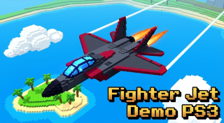
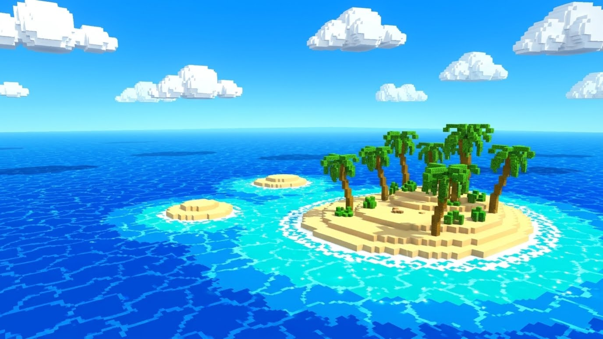
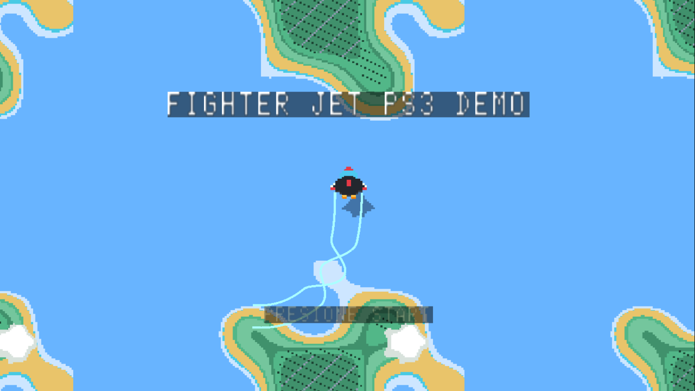
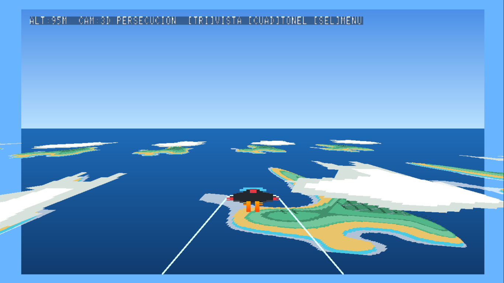
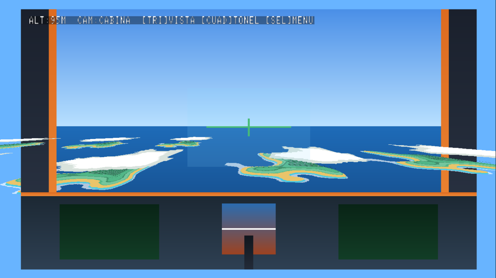

  
  <h1>✈️ Fighter Jet PS3 Demo (v0.3)</h1>
  
<strong>Demo técnico de vuelo arcade en pixel-art 3D nativo para PlayStation 3</strong>

  
Desarrollado en C con <strong>PSL1GHT</strong> y aceleración por hardware RSX mediante <strong>Tiny3D</strong>.

  

---

## 🎮 Estado Actual (v0.3 - Jugable en PS3 Real)
**Esta versión ya es ejecutable y jugable directamente en hardware real PlayStation 3 (probado en PS3 Super Slim con HEN)**, además del emulador RPCS3.

* **Compatibilidad Hardware Real RSX:** Texturas y fuentes alineadas a 128 bytes en VRAM para evitar bloqueos gráficos.
* **Menú Principal con Piloto Automático:** Pantalla interactiva (*PRESIONE START*) con maniobras autónomas sobre las islas.
* **Sistema de 3 Cámaras en Tiempo Real (`Triángulo`):** Vista Cenital (7 capas de sprite stacking), Vista 3D de Persecución (cielo, mar e islas en perspectiva) y Vista de Cabina (primera persona con radar, HUD y joystick dinámico).

---

## 🐛 Reporte de Fallos (Issues) y Archivo de Diagnóstico (Log)
Al tratarse de una versión en desarrollo activo (`v0.3`), puedes reportar incidencias en la pestaña **Issues** adjuntando el archivo de registro generado por el juego:

* **Ruta del log en tu PS3:** `/dev_hdd0/ps3_fighter.log`
* **Extracción:** Cópialo a una memoria USB mediante **multiMAN / IRISMAN** o descárgalo por FTP (puerto `21`) con **webMAN MOD**.

---

## 📸 Capturas de Pantalla y Controles
Consulta el repositorio para ver las capturas de las vistas cenital, 3D y cabina. Los controles en DualShock 3 incluyen el stick para girar, `X`/`R2` para postcombustión, `Cuadrado` para tonel volado, `Triángulo` para cambiar cámara, `Start` para iniciar y `Select` para volver al menú.##

| Vista Cenital (Top-Down) | Vista 3D Persecución | Vista de Cabina (HUD) |
| :---: | :---: | :---: |
|  |  |  |

## 🙏 Créditos e Inspiración
* **Concepto original:** Inspirado en [*fighter · Forge*](https://ui8.ai) (UI8 Forge).
* **Librerías Homebrew:** Desarrollado sobre [PSL1GHT](https://github.com/ps3dev/PSL1GHT) y [Tiny3D](https://github.com) de Hermes.
